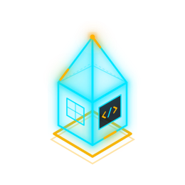

BORDEAUX, FRANCE &nbsp; / &nbsp; LIB-LOCALE

# Anthony Blanchard

### Des outils utiles. Des interfaces soignées. Une attention aux détails, dans chaque langue.

QA & test applicatif · Support utilisateur · Développement front-end

[**Voir mon portfolio ↗**](https://anthony-blanchard-portfolio.netlify.app/) &nbsp; · &nbsp; [Explorer mes projets](https://github.com/Lib-LOCALE?tab=repositories)

 

 

Je conçois des applications **web et desktop multilingues**, avec le même souci du détail pour l'interface, les tests et la documentation. Mon parcours relie la QA, le support applicatif et le développement : comprendre un problème, le reproduire, puis améliorer l'expérience.

## Une sélection de mes projets

<table>
<tr>
<td width="50%" valign="top">
<h3><a href="https://github.com/Lib-LOCALE/ondrane">Ondrane ↗</a></h3>

Vos médias. Votre rythme.

Un lecteur desktop pour les vidéos, la musique et les flux réseau. Bibliothèque, sous-titres, thèmes et intégration Wayland. Disponible en préversion.

Rust · Slint · libVLC

<a href="https://github.com/Lib-LOCALE/ondrane"><b>Le code</b></a> &nbsp; · &nbsp; <a href="https://github.com/Lib-LOCALE/ondrane/releases">Les préversions</a>

</td>
<td width="50%" valign="top">
<h3><a href="https://github.com/Lib-LOCALE/calculatrice">Calculette ↗</a></h3>

Les bons calculs, dans vos couleurs.

Une calculatrice pour Linux et Wayland : modes standard et scientifique, calcul décimal en Rust, historique et thèmes. Six langues et distribution Flatpak.

Svelte · TypeScript · Tauri · Rust

<a href="https://github.com/Lib-LOCALE/calculatrice"><b>Le code</b></a> &nbsp; · &nbsp; <a href="https://github.com/Lib-LOCALE/calculatrice/releases/latest">Télécharger</a>

</td>
</tr>
<tr>
<td width="50%" valign="top">
<h3><a href="https://github.com/Lib-LOCALE/TomatoTask">TomatoTask ↗</a></h3>

La concentration prend des couleurs.

Un minuteur Pomodoro et un gestionnaire de tâches où chaque session terminée peint un carreau. Données locales, cinq langues, Windows et Linux.

Svelte · TypeScript · Tauri · SQLite

<a href="https://github.com/Lib-LOCALE/TomatoTask"><b>Le code</b></a> &nbsp; · &nbsp; <a href="https://github.com/Lib-LOCALE/TomatoTask/releases/latest">Télécharger</a>

</td>
<td width="50%" valign="top">
<h3><a href="https://github.com/Lib-LOCALE/FMToolsV2">FMToolsV2 ↗</a></h3>

Mieux comprendre son équipe.

Des outils d'analyse pour Football Manager : joueurs, staff, rapports et infrastructures. Interface et documentation multilingues, Windows et Linux.

Svelte · TypeScript · Tauri · Rust

<a href="https://github.com/Lib-LOCALE/FMToolsV2"><b>Le code</b></a> &nbsp; · &nbsp; <a href="https://github.com/Lib-LOCALE/FMToolsV2/releases/latest">Télécharger</a>

</td>
</tr>
</table>

<b>Au laboratoire — NewGAN Manager 26</b>

 

Une réécriture expérimentale de NewGAN Manager avec **Tauri et Svelte**, pour Football Manager 26.

**Projet en pause** : les changements du processus d'export de FM 26 bloquent l'extraction des identifiants de joueurs.

[Explorer le dépôt ↗](https://github.com/Lib-LOCALE/NewGAN-Manager-26)

## Du premier bug à la dernière traduction

| Tester & comprendre | Construire & livrer |
| :--- | :--- |
| Validation fonctionnelle et scénarios de test | Interfaces avec Svelte, TypeScript, Vite et Tailwind CSS |
| Reproduction et qualification des anomalies | Applications desktop avec Tauri, Rust, Slint et SQLite |
| Support applicatif et retours utilisateurs | Livraisons Windows et Linux avec GitHub Actions |
| Documentation claire et accompagnement | Internationalisation des interfaces et des guides |

## Travaillons ensemble

Je recherche un poste en **QA, support applicatif ou développement front-end**, pour contribuer à des logiciels fiables et agréables à utiliser.

**[Retrouve mon parcours et mes projets sur mon portfolio ↗](https://anthony-blanchard-portfolio.netlify.app/)**

---

<b>English version</b>

 

### Hi, I'm Anthony.

Based in Bordeaux, France, I build **multilingual web and desktop applications**. My background brings together QA, application support and front-end development, with a focus on usability, reliability and clear documentation.

**Selected work**

- **[Ondrane](https://github.com/Lib-LOCALE/ondrane)** — A desktop media player built with Rust, Slint and libVLC. Video, music, network streams, a media library and Wayland integration. Available as a preview.
- **[Calculette](https://github.com/Lib-LOCALE/calculatrice)** — A standard and scientific calculator for Linux and Wayland, with Rust decimal arithmetic, history, themes and six languages. Distributed as a Flatpak.
- **[TomatoTask](https://github.com/Lib-LOCALE/TomatoTask)** — A local-first Pomodoro timer and task manager. Each completed session paints a tile in a growing fresco. Five languages, Windows and Linux.
- **[FMToolsV2](https://github.com/Lib-LOCALE/FMToolsV2)** — Desktop tools for Football Manager: player and staff analysis, reports and club infrastructure, with multilingual UI and documentation.
- **[NewGAN Manager 26](https://github.com/Lib-LOCALE/NewGAN-Manager-26)** — An experimental Tauri/Svelte rewrite, paused following changes to FM 26's player-ID export workflow.

**What I work with:** Svelte, TypeScript, Tauri, Rust, Slint, SQLite, Vite, Tailwind CSS and GitHub Actions.

I am looking for opportunities in **QA, application support or front-end development**.

[My portfolio ↗](https://anthony-blanchard-portfolio.netlify.app/)

